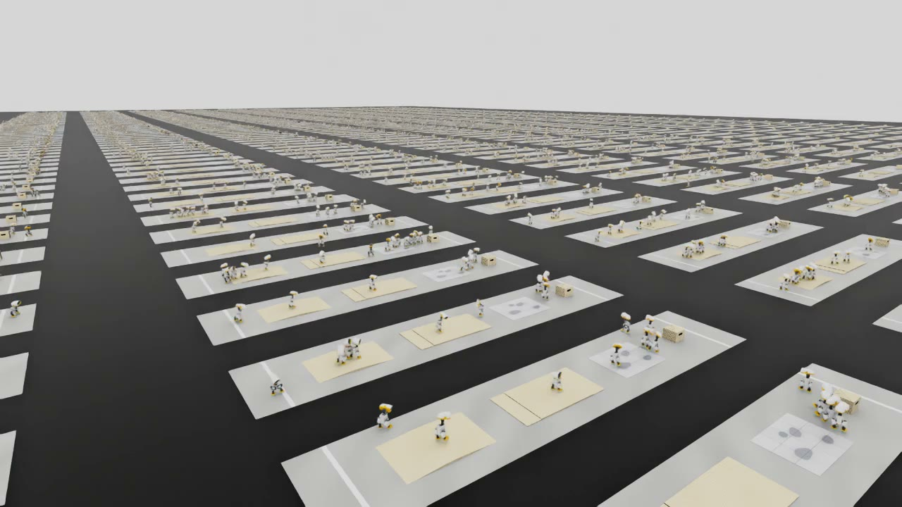
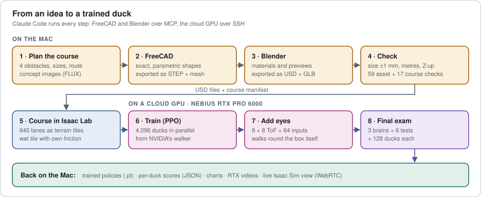
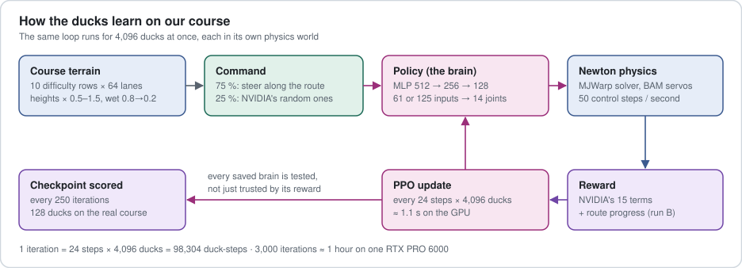
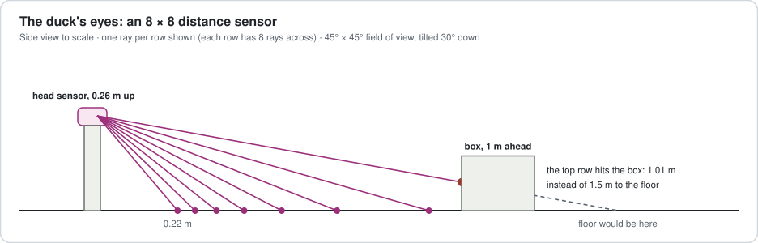
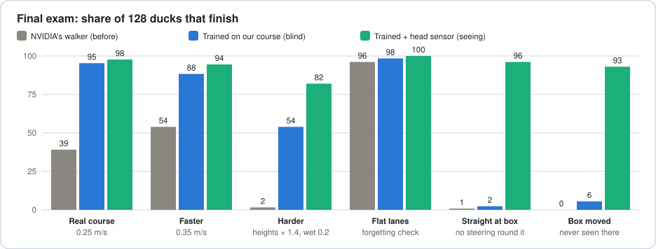
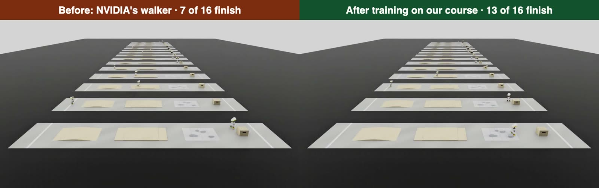
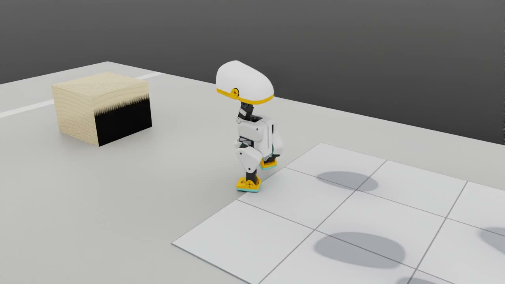

<div align="center">

# Microduck Obstacle Course

**Teaching a 25 cm robot duck to cross an obstacle course in simulation, and to see an obstacle and walk around it, with Isaac Lab, Newton and 4,096 ducks training at once.**

A reproduction of NVIDIA's GTC Berlin 2026 agentic Microduck workflow, built end to end by Claude Code: course design in FreeCAD and Blender, the course as an Isaac Lab task, GPU training on a rented cloud GPU, and a 128-duck final exam.

[](https://github.com/isaac-sim/IsaacLab)
[](https://docs.isaacsim.omniverse.nvidia.com/latest/index.html)
[](https://github.com/newton-physics/newton)
[](https://github.com/leggedrobotics/rsl_rl)
[](https://www.python.org/)
[](https://nebius.com/)
<br>
[](https://www.freecad.org/)
[](https://www.blender.org/)
[](tooling/README.md)
[](#limitations)
[](#results)
[](LICENSE)



<p><sub>4,096 Microducks practise on 640 copies of the course at once (Isaac Sim, RTX).</sub></p>

</div>

---

## Contents

[What it does](#what-it-does) · [Limitations](#limitations) · [How it works](#how-it-works) · [Results](#results) · [Tech stack](#tech-stack) · [Repository layout](#repository-layout) · [Getting started](#getting-started) · [Reproduce our numbers](#reproduce-our-numbers) · [Cost](#cost-and-time) · [How it was built](#how-it-was-built) · [Resources](#resources) · [Credits](#credits) · [License](#license)

## What it does

- **Designs and builds a small obstacle course** for [Pollen Robotics' Microduck](https://pollen-robotics.com/microduck/): a 3.3 cm hump, two 1 cm plywood steps, a slippery wet tile (friction 0.3) and a 20 × 20 × 15 cm box, on a 6 × 1.2 m lane. Every obstacle is a parametric FreeCAD model, dressed in Blender and exported as USD, and can be rebuilt from scripts.
- **Turns the course into an Isaac Lab training task** on top of NVIDIA's released rough-terrain Microduck task: 10 difficulty rows × 64 lanes, a wet tile that really slips (contact priority, see below), steering along the route, and a curriculum.
- **Fine-tunes NVIDIA's walking policy** on the course with 4,096 ducks in parallel. The finish rate on the real course goes from **39 % to 95 %**.
- **Gives the duck eyes**: the real robot's 8 × 8 time-of-flight distance sensor as 64 extra inputs. Sent straight at the box with nobody steering, **96 %** of the ducks walk around it, and **93 %** when the box is moved somewhere it never was in training.
- **Scores every policy fairly**: 128 ducks per test, six tests, per-duck reports (finished, falls and where, box contact, speed asked vs measured).
- **Shows it live**: Isaac Sim runs on the cloud GPU and streams to a Mac over WebRTC.

## Limitations

**Read this before relying on anything here.** Everything ran in simulation; nothing has been run on a physical Microduck.

| Ability | Status | Notes |
|---|---|---|
| Walk the course when steered along the route | ✅ Yes | 95 % (blind) / 98 % (seeing) of 128 ducks finish |
| Walk a harder-than-real course (heights × 1.4, friction 0.2) | 🟡 Mostly | 54 % blind, 82 % seeing |
| See an obstacle and walk around it, no steering | ✅ One box | Tested with one box on one lane only |
| Walk on flat ground as before | ✅ Yes | 98–100 %: no forgetting |
| Stop and stand still | ✅ Yes | Walk command = 0 |
| Walk backwards, sideways, turn on the spot | 🟡 Untested | Inside the trained command range, not re-tested after our training |
| Choose a goal, plan a path, handle several obstacles | ❌ No | It follows a route someone gives it; it only reacts to what is about 1.5 m ahead |
| Understand words ("start the course") | ❌ No | Needs a command layer on top |
| See colours or recognise objects | ❌ No | Its eyes are 64 distances, not a camera image |
| Sit, stand up, kick, pick up | ❌ No | Our policies only walk. Pollen ships those as separate policies for the real robot |
| Run on the real robot | ❌ Not tried | The blind policy has the robot's 61-input format; the seeing policy needs real ToF readings in the same order and scale |

Other limitations:

- **Idealised sensor.** The ToF model is 64 perfect rays updated 50 times a second with ±2 cm noise. The real VL53L5CX gives 8 × 8 zones at up to 15 Hz, with sunlight, reflectivity and dropout effects.
- **The duck's body has no colliders.** NVIDIA's walking robot model only collides through its soles, so "touching the box" is measured geometrically, not felt.
- **Fixed course layout.** The training varies heights and friction, not where the obstacles are (apart from the moved-box test).
- **Comparisons.** The seeing policy trained 2,000 iterations more than the blind one, so on the normal, faster and harder tests part of its lead is extra training. The two box tests are unaffected: a blind duck has no way to know where the box is.
- **One seed per test** (128 ducks). Expect a few points of variation between runs.
- **Isaac Lab `main` moves.** The Microduck code exists only on `main` (not in a release); we pin commit `727e4e43a` and apply a one-line patch. Open pull requests (#8613, #8657) would change rewards and the servo model.
- **Account-specific cloud scripts.** `cloud/nebius/workstation.*.env` holds the VM settings; your Nebius project, network and subnet IDs go in a `workstation.<region>.local.env` next to it (git-ignored), and the scripts stop if they're missing.

## How it works

### The pipeline



### The training loop

Reinforcement learning by trial and error: each duck's **policy** (a small neural network) turns what it senses into 14 joint targets 50 times a second; Newton simulates the physics; a **reward** scores the walking; **PPO** nudges the network towards what scored well. All 4,096 ducks do this at once.



Key choices (each one explained, with alternatives, in the code's docstrings):

- **Start from NVIDIA's walker**, not from zero (about 15 h saved), and pin NVIDIA's training schedules at their final values (they restart on resume otherwise).
- **The wet floor needs contact priority.** Newton's MuJoCo solver uses the *larger* of two touching frictions, so a 0.3 tile under a 1.0 foot would behave like 1.0. The wet tiles carry `MujocoCollisionCfg(priority=1)`, so their own friction applies. An ice test (friction 0.02) confirmed it: 62 of 64 ducks fell on the tile.
- **One extra reward, route progress.** With NVIDIA's rewards alone, fine-tuning made the ducks walk at under half the commanded speed (finishes fell from 65 to 1 of 128). Rewarding speed along the route, capped at the commanded speed, fixed it.
- **Every checkpoint is scored on the real course while training runs**, because a healthy-looking reward curve hid the slowdown above.

### The duck's eyes



The 64 new inputs are added with **zero weights** to a copy of the trained blind policy (`expand_checkpoint.py`), so training starts from exactly the blind walker and only has to learn what the sensor adds.

## Results



| Test (128 ducks each, head held forward) | NVIDIA's walker | Trained, blind | Trained, seeing |
|---|---:|---:|---:|
| Real course, 0.25 m/s | 39 % | 95 % | **98 %** |
| Faster, 0.35 m/s | 54 % | 88 % | **94 %** |
| Harder: heights × 1.4, wet floor 0.2 | 2 % | 54 % | **82 %** |
| Flat lanes (forgetting check) | 96 % | 98 % | **100 %** |
| Straight at the box, no steering | 1 % | 2 % | **96 %** |
| Box moved 40 cm earlier (never seen there) | 0 % | 6 % | **93 %** |

<table><tr>
<td width="62%"><p><sub>The same 16 lanes before (left) and after training (right).</sub></p></td>
<td width="38%"><p><sub>Told only "walk straight": the seeing duck steps around the box.</sub></p></td>
</tr></table>

## Tech stack

| Layer | Tools |
|---|---|
| Agent | [Claude Code](https://claude.com/claude-code), with the FreeCAD and Blender MCP servers ([details](tooling/README.md)) |
| Course design | FreeCAD 1.1.4 (parametric shapes, STEP), Blender 5.2.2 (materials, previews, USD/GLB), FLUX 3 (concept images) |
| Scene format | OpenUSD (`usd-core`), `trimesh` for collision geometry |
| Simulation and training | Isaac Lab 3.0 (`main@727e4e43a`), Newton (MJWarp solver, BAM servo model), RSL-RL (PPO) |
| Rendering and live view | Isaac Sim 6.2 (RTX), Isaac Sim WebRTC Streaming Client 2.0.0 |
| Compute | Nebius VM, NVIDIA RTX PRO 6000 Blackwell (96 GB), Ubuntu 24.04, driver 610.57, CUDA 13.3 |
| Tooling | `uv`, Nebius CLI, `ssh`/`rsync`/`tmux`, `ffmpeg`, `matplotlib`, `tensorboard` |

## Repository layout

```text
.
├── assets/<id>/                  # each obstacle: model.usd + its textures
│   └── build/                    # rebuild it: FreeCAD + Blender scripts and build.sh
├── pipeline/                     # course layout and asset inventory (layout.json, inventory.json) and the assembled-course manifest
├── scenes/build_course_usd.py    # the whole course as one USD scene with physics, checked against the manifest
├── training/
│   ├── isaaclab_ext/             # our Isaac Lab code (see the table below)
│   └── runs/phase*/              # the exact script behind every training and evaluation run
├── cloud/nebius/                 # create / start / stop / sync / stream / destroy the GPU workstation
├── tools/                        # FreeCAD/Blender driver, asset and course checks, plots, recorders, README diagrams
├── tooling/README.md             # every tool used to build the project, with versions
└── .github/readme/               # the images and diagrams on this page (diagrams: tools/readme_diagrams.py)
```

Not in the repository: trained checkpoints, run results, videos and renders (large, regenerated by the scripts), the 3D authoring files (`.FCStd`, `.blend`, `.step`, `.glb`, rebuilt by each `build.sh`), and the working notes, course plan and build log.

| File in `training/isaaclab_ext/` | What it is |
|---|---|
| `course_geometry.py` | The course's shapes and route, written once, used by training, scoring and the scene file |
| `course_env_cfg.py` | The course task: terrain tiles, wet tiles with priority, route steering, spawns, curriculum, progress reward |
| `course_depth_cfg.py` | The seeing version: the 8 × 8 ToF sensor, its observation, the box-contact penalty |
| `eval_course.py` | The scorer: one lane per duck, per-duck JSON report |
| `expand_checkpoint.py` | Widens a policy's inputs with zero weights (61 → 125) |
| `course_cam_cfg.py`, `chase_cam_cfg.py` | Cameras for videos and the live stream |
| `register.py`, `launch.py` | Register our task ids and run Isaac Lab's `train` / `play` |

## Getting started

### Requirements

- **For training and evaluation:** a Linux machine with a recent NVIDIA GPU and driver (we used an RTX PRO 6000 with driver 610.57; Isaac Lab asks for ≥ 595.58.03), `git` and [`uv`](https://docs.astral.sh/uv/). RTX rendering and the live view need an RT-core GPU (e.g. L40S, RTX PRO 6000); headless training runs on any CUDA GPU.
- **Optional, to rebuild the obstacles:** a Mac or PC with FreeCAD 1.1.x and Blender 5.2.x and their MCP add-ons ([tooling](tooling/README.md)). Training doesn't need the 3D models: the collision geometry comes from `course_geometry.py`.
- **Optional, a rented GPU:** a [Nebius](https://nebius.com/) account and the Nebius CLI, if you use our workstation scripts.

### 1. Get a GPU machine

Either use your own Linux GPU machine, or create the Nebius workstation from a Mac or Linux laptop:

```bash
git clone <this repository> && cd <repository>
# your Nebius IDs (git-ignored); check SSH_KEY and the rest in workstation.eu-south1.env
printf 'PROJECT=project-…\nNETWORK=vpcnetwork-…\nSUBNET=vpcsubnet-…\n' > cloud/nebius/workstation.eu-south1.local.env
cloud/nebius/create.sh        # firewall (your IP only), 250 GiB disk, RTX PRO 6000 VM — costs money from here
cloud/nebius/ssh.sh           # log in; status.sh / stop.sh / start.sh manage it later
```

### 2. Install Isaac Lab with the Microduck tasks (on the GPU machine)

```bash
# from the laptop: copy the setup script and the patch, then run it on the VM
scp -r cloud/nebius/setup_vm.sh cloud/nebius/patches duck@<vm-ip>:~/
cloud/nebius/ssh.sh 'bash ~/setup_vm.sh 2>&1 | tee ~/setup.log'
```

`setup_vm.sh` (9 logged steps) checks the GPU and Vulkan, clones Isaac Lab at `727e4e43a`, runs `uv sync`, applies our one-line patch, creates a Newton-only environment for training (`.venv-newton`) and installs Isaac Sim 6.2 for rendering and the live view. Running Isaac Sim requires accepting the NVIDIA Omniverse License Agreement: only if you accept it, run the script with `ACCEPT_OMNIVERSE_EULA=yes`, which writes `~/isaac-env.sh`.

On your own machine, the equivalent is `git clone https://github.com/isaac-sim/IsaacLab.git && cd IsaacLab && git checkout 727e4e43a && uv sync && git apply <repo>/cloud/nebius/patches/*.patch`.

### 3. Copy our code and fetch NVIDIA's walker

```bash
cloud/nebius/sync.sh up       # training/isaaclab_ext/ → ~/isaaclab_ext, course models → ~/isaac-obstacle-course/assets
# on the VM, download NVIDIA's pretrained checkpoint once by playing it:
cd ~/IsaacLab && UV_PROJECT_ENVIRONMENT=~/IsaacLab/.venv-newton uv run --extra video isaaclab play \
  --rl_library rsl_rl --task IsaacContrib-Velocity-Rough-MicroDuck --checkpoint pretrained --num_envs 16 presets=backlash \
  --video newton_gl --video_length 100
```

### 4. Train on the course (~1 hour)

```bash
cd ~/IsaacLab && export UV_PROJECT_ENVIRONMENT=~/IsaacLab/.venv-newton ROUTE_PROGRESS_WEIGHT=1.5
PYTHONPATH=~/isaaclab_ext uv run --extra video python ~/isaaclab_ext/launch.py train --rl_library rsl_rl \
  --task IsaacContrib-Velocity-Course-MicroDuck --num_envs 4096 presets=backlash \
  --checkpoint <NVIDIA's rough backlash .pt> --max_iterations 3000 --run_name course_finetune
```

Run it inside `tmux`. Checkpoints land in `~/IsaacLab/logs/rsl_rl/microduck_velocity_rough_backlash/<date>_course_finetune/`.

### 5. Score a policy on the real course

```bash
PYTHONPATH=~/isaaclab_ext uv run --extra video python ~/isaaclab_ext/eval_course.py \
  --task IsaacContrib-Velocity-Course-MicroDuck --checkpoint <model.pt> --num_envs 128 presets=backlash \
  --no_visuals --out ~/eval/my_run.json            # options: --speed 0.35 --height_scale 1.4 --wet_friction 0.2
```

It prints a summary (finished, falls and where, speed) and writes one row per duck to the JSON file.

### 6. Give the duck eyes (~50 minutes)

```bash
.venv-newton/bin/python ~/isaaclab_ext/expand_checkpoint.py <blind model.pt> ~/ckpt/depth_init.pt --actor-add 64 --critic-add 64
PYTHONPATH=~/isaaclab_ext uv run --extra video python ~/isaaclab_ext/launch.py train --rl_library rsl_rl \
  --task IsaacContrib-Velocity-Course-MicroDuck-Depth --num_envs 4096 presets=backlash \
  --checkpoint ~/ckpt/depth_init.pt --max_iterations 2000 --run_name course_depth
# test it without steering, and with the box moved:
... eval_course.py --task IsaacContrib-Velocity-Course-MicroDuck-Depth --route straight [--box_x 4.7] ...
```

### 7. Watch it live (needs Isaac Sim and the WebRTC client)

```bash
COURSE=1 DEPTH=1 ROUTE=straight VIEW=chase cloud/nebius/stream.sh <checkpoint on the VM>
# connect the Isaac Sim WebRTC Streaming Client to the VM's IP, then:
cloud/nebius/stream.sh stop
```

### 8. Stop paying

```bash
cloud/nebius/stop.sh                     # keeps the disk (~$0.58/day)
CONFIRM=yes cloud/nebius/destroy.sh      # deletes the VM, disk and firewall rules
```

## Reproduce our numbers

Each run's exact script is in `training/runs/` (run them on the GPU machine):

| Script | What it reproduces |
|---|---|
| `phase5-before/run_before.sh` | NVIDIA's walker on our course before any training (128 ducks), plus RTX videos |
| `phase6-course/run_train.sh` | Run A: NVIDIA's rewards only (the run that made the ducks slower) |
| `phase6-course/run_train_b.sh` | Run B: with the route-progress reward (the blind policy in the results) |
| `phase6-course/eval_checkpoints.sh` | Scores every checkpoint while training runs (`--follow`) |
| `phase6-course/run_train_video.sh` | The 4,096-ducks training video |
| `phase6b-depth/run_train_depth.sh` | The seeing policy |
| `phase7-validate/run_validate.sh` | The six-test final exam for all three policies, plus videos |

## Cost and time

On one Nebius RTX PRO 6000 at $1.80/hour: **4 h 50 min of GPU time, about $8.71**, over three sessions. Run B (3,000 iterations) took 62.7 min; the seeing policy (2,000 iterations) 49.7 min; a 128-duck test about 45 s. Speed: about 84,000 simulated duck-steps per second at 4,096 ducks. Course design on the Mac cost nothing.

## How it was built

The whole project was carried out by **Claude Code**, steered by a person who chose the goals and approved every paid or public step. It drove FreeCAD and Blender through their MCP servers, the cloud GPU through the Nebius CLI and SSH, and recorded every build so it can be replayed. The full list of tools and versions: [`tooling/README.md`](tooling/README.md).

## Resources

**NVIDIA's workflow (what this project reproduces)**

- [Using AI agents to teach robots like Microduck to walk in simulation](https://developer.nvidia.com/blog/using-ai-agents-to-teach-robots-like-microduck-to-walk-in-simulation/): NVIDIA's technical blog on the full GTC Berlin 2026 workflow (plan → concept image → FreeCAD/Blender → USD → Isaac Sim → Isaac Lab training → validation).
- [Train in simulation, deploy on a real robot: Microduck with Isaac Lab 3.0](https://huggingface.co/blog/nvidia/microduck-isaac-lab-sim-to-real): the Hugging Face tutorial for the walking policy (install, train, play, export ONNX, deploy).
- [GTC Berlin 2026 keynote clip](https://www.youtube.com/watch?v=VvJai6HGfyE): the demo video the course design follows.
- [Isaac Lab Microduck tasks](https://github.com/isaac-sim/IsaacLab/tree/main/source/isaaclab_tasks/isaaclab_tasks/contrib/microduck): the released walking tasks, robot config and BAM servo model that our course task builds on.
- [Microduck walking demo in the browser](https://isaac-sim.github.io/IsaacLab/demos/v3/?demo=microduck): NVIDIA's walker with BAM servos, running in WebAssembly.

**Frameworks**

- [Isaac Lab 3.0 docs](https://isaac-sim.github.io/IsaacLab/v3.0.0-EA/index.html) and the [Isaac Lab learning path](https://docs.nvidia.com/learning/physical-ai/getting-started-with-isaac-lab/latest/index.html)
- [Isaac Sim docs](https://docs.isaacsim.omniverse.nvidia.com/latest/index.html) · [Newton physics](https://developer.nvidia.com/newton-physics) · [Rhoban BAM](https://github.com/Rhoban/bam) (servo model)
- [SimReady Central assets](https://huggingface.co/blog/nvidia/simready-central-assets-robotics-ai-factories): ready-made USD assets for robotics scenes

**The robot**

- [Microduck by Pollen Robotics](https://pollen-robotics.com/microduck/): the 25 cm robot, its sensors and specs.
- [`pollen-robotics/microduck_rl`](https://github.com/pollen-robotics/microduck_rl): Pollen's original training code (walk, stand up, sit/stand, kick, roll, roller-skating) and [`pollen-robotics/microduck`](https://github.com/pollen-robotics/microduck): the real robot's runtime.
- [NVIDIA DLI Microduck Workshop](https://nv-dli.github.io/Microduck-Workshop/en/index.html) ([code](https://github.com/NV-DLI/Microduck-Workshop)): perception, navigation and learned skills combined into autonomous football.
- [awesome-microduck](https://github.com/joeynyc/awesome-microduck): community list of Microduck software, simulators and ports.

**Running it in the cloud**

- [Isaac Sim on Nebius](https://github.com/chloepilonv/isaacsim_nebius): the Vulkan driver libraries, WebRTC ports and streaming kit that our workstation scripts follow.
- [Nebius compute pricing](https://docs.nebius.com/compute/resources/pricing): RTX PRO 6000 and L40S hourly rates.

## Credits

- **[Pollen Robotics](https://pollen-robotics.com/)** and **[Hugging Face](https://huggingface.co/)**: the Microduck robot, its model and its original training code ([`microduck_rl`](https://github.com/pollen-robotics/microduck_rl)).
- **NVIDIA**: [Isaac Lab](https://github.com/isaac-sim/IsaacLab) (including the released Microduck walking tasks and pretrained checkpoints), Isaac Sim, [Newton](https://github.com/newton-physics/newton), and the GTC Berlin 2026 workflow ([blog](https://developer.nvidia.com/blog/using-ai-agents-to-teach-robots-like-microduck-to-walk-in-simulation/), [Hugging Face tutorial](https://huggingface.co/blog/nvidia/microduck-isaac-lab-sim-to-real)).
- **[Rhoban BAM](https://github.com/Rhoban/bam)**: the servo model used in training.
- **[FreeCAD MCP](https://github.com/neka-nat/freecad-mcp)** and **[Blender MCP](https://github.com/ahujasid/mcp-for-blender)**.

This project is independent and not affiliated with or endorsed by NVIDIA, Pollen Robotics or Hugging Face.

## License

This project's own code, scripts and models are released under the **[MIT License](LICENSE)**.

Third-party terms still apply when you use it with the tools it builds on: Isaac Lab is BSD-3-Clause; Isaac Sim and Omniverse Kit fall under the NVIDIA Omniverse License Agreement; the Microduck robot model is Pollen Robotics' (downloaded at runtime by Isaac Lab, not redistributed here); NVIDIA's pretrained checkpoints carry their own model card.
